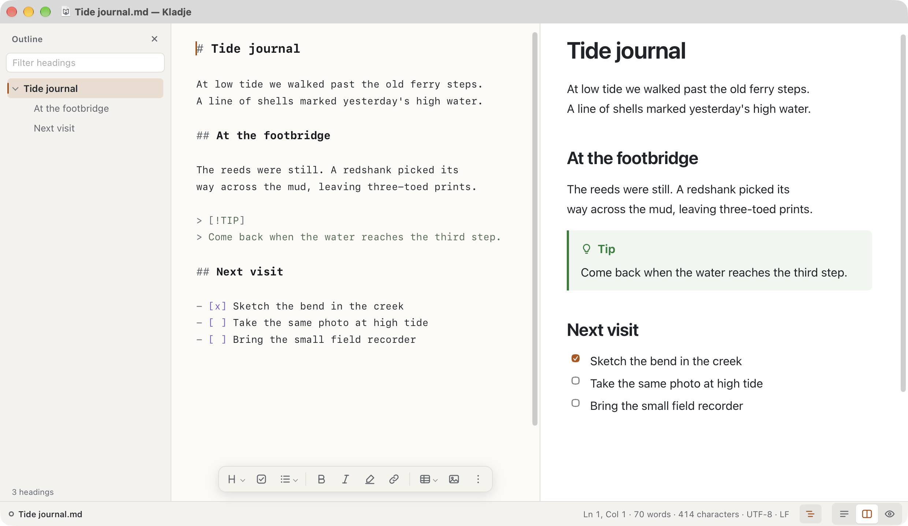

<h1></h1>

Kladje is a lightweight Markdown editor for Mac. Open a note, start writing, and see the finished page beside your text. When a draft grows, use the outline to jump between sections. Your documents stay in the folders you choose, as ordinary Markdown files you can open in any editor.

<picture>
  <source media="(prefers-color-scheme: dark)" srcset="docs/screenshots/outline-dark.png">
  
</picture>

## Writing in Kladje

Drag a photo into a field note, tick an item off a checklist, or open yesterday’s notes in a second window while you write. Switch to the editor-only view when you want more room to write. When you’re ready to share it, export HTML or save a PDF through the Mac print dialog.

## Your files

Kladje works offline. Save with **⌘S** or turn on automatic saving. If another app changes a file while you have edits of your own, automatic saving pauses so you can compare the two versions. After an unexpected quit, Kladje can offer to restore a recent draft.

## Availability

The first macOS preview is being tested on Macs with Apple silicon.

Explore the [start screen](docs/screenshots/start.png) and [settings](docs/screenshots/settings.png), or read the [Markdown Guide](ui/guide.md) for tips and shortcuts.

Try the [Markdown compatibility test](tests/compatibility/) to see how tables, images and diagrams appear in the preview and in exports.

Kladje’s source code is available under the [MIT License](LICENSE). The Kladje name, icon and wordmark are reserved for Kladje.
