# Kladje Markdown Test Document

This document exercises a Markdown editor or renderer from the plain basics to the awkward corners. Open it with the folder it came in, because several tests point at files beside it:

| Folder | Contents |
| --- | --- |
| `media/` | One labelled image per format and path case. Each image names its own format and file, so a wrong file is easy to spot. |
| `notes/` | Small notes that the link and wiki-link tests point to. |
| `fixtures/` | Separate files for line endings, encodings, empty files and unsafe HTML. Open them one by one. |

## How to read the tests

Every test has a code and a tag that says where the syntax comes from:

- **[CM]** CommonMark, which every Markdown application should follow.
- **[GFM]** GitHub Flavored Markdown, a widely used superset.
- **[EXT]** A common extension without one shared specification.
- **[OBS]** Obsidian syntax.
- **[HTML]** Raw HTML inside Markdown.
- **[APP]** Application behaviour rather than syntax: files, paths, safety and export.

Under each test, **Look for** lists what to check. Mark the outcome with one of these symbols in the scorecard at the end:

| Symbol | Meaning |
| :---: | --- |
| ✅ | Works as the source intends. |
| ◐ | Usable, but formatting, metadata or exact source changes. |
| ○ | Not supported, and the source stays visible and intact. |
| ✗ | Content disappears, changes meaning or cannot be recovered. |
| – | Not checked. |

An unsupported extension is not a defect as long as the source survives. Losing text is.

---

# Part A — Block structure

## A1. ATX headings [CM]

# Level one
## Level two
### Level three
#### Level four
##### Level five
###### Level six

## A heading with a closing sequence ##

### A heading that ends in an escaped hash \#

####### Seven hashes make a paragraph, not a heading

#No space after the hash, so this is a paragraph too

#

The line above is an empty level-one heading.

**Look for:** six distinct levels; the closing `##` hidden; the escaped `#` shown; the seven-hash and no-space lines shown as ordinary text; the empty heading not breaking the outline.

## A2. Setext headings [CM]

An underlined heading
spread over two source lines
=============================

A second-level underlined heading
---

**Look for:** the first heading keeps both source lines as one heading; a single `---` under text makes a heading, not a rule.

## A3. Headings with the same text [APP]

### Results

The first heading called "Results".

### Results

The second heading called "Results".

### Anchor target: Ünïcode & Punctuation!

**Look for:** both "Results" headings appear in the outline in order and stay distinguishable; generated anchors differ, for example `#results` and `#results-1`. Try the heading links in F6.

## A4. Paragraphs and line breaks [CM]

These two source lines
belong to one paragraph and should flow together.

Two trailing spaces end this line  
so this one starts on a new line.

A backslash ends this line\
so this one starts on a new line as well.

An HTML break tag ends this line<br>
which most renderers honour.

A backslash at the very end of a paragraph stays a backslash\

   
The line above this one contains only spaces and still separates two paragraphs.

**Look for:** In Kladje, open **Settings → Preview** and try **Show a single Return as a line break** both ways. With it off, the first pair flows together. With it on, the second line starts on a new line in the preview and in HTML and PDF exports. In both modes, check the three explicit breaks, the literal backslash at the end of its paragraph and the trailing spaces after saving.

## A5. Thematic breaks [CM]

---

* * *

_____

-  -  -

**Look for:** four horizontal rules. A dashed line straight under a paragraph would turn that paragraph into a heading, as A2 shows.

## A6. Block quotes [CM]

> A quote whose second line is lazy,
continuing without its own marker.

> A quote with two paragraphs.
>
> The second one is still quoted.

> Outer quote
>
> > Inner quote
> >
> > > Third level

> ## A heading in a quote
>
> 1. A numbered list
> 2. in a quote
>
> ```js
> const inQuote = true;
> ```
>
> | Quoted | table |
> | --- | --- |
> | one | two |

**Look for:** the lazy line stays inside the first quote; three nesting levels; heading, list, code and table all rendered inside the last quote.

## A7. Lists [CM]

- Hyphen item
- Another hyphen item
+ A plus sign starts a new list
+ because the marker changed
* An asterisk starts a third list

Ordered lists with both delimiters:

1. Period-delimited
2. ordered list

1) Parenthesis-delimited
2) ordered list

A list that starts at zero:

0. zero
1. one

A list that starts at 2026:

2026. first
2027. second

A tight list:

- no blank lines
- between items

A loose list:

- blank lines

- between items

Four levels of nesting:

- Level one
  - Level two
    - Level three
      - Level four

Items with more than one block:

1. An item with a second paragraph

   This paragraph belongs to item one.

       This line is indented code inside the item.

2. An item with a fenced block

   ```text
   fenced code inside a list item
   ```

3. An item whose text continues
on a lazy line.

An item whose first line is empty:

-
  An item that starts with a blank line.

A paragraph line
- followed straight away by a bullet list.

A paragraph line
2. followed by "2." does not start a list, because only "1." may interrupt a paragraph.

**Look for:** three separate bullet lists; both ordered delimiters; start numbers 0 and 2026 respected; tight and loose spacing; four nesting levels; the code, fence and lazy line staying in their items; the last example rendered as one paragraph.

## A8. Code blocks [CM]

Indented by four spaces:

    indented code, line one
    indented code, line two
        deeper indentation is kept

Fenced with backticks and tildes:

```
A fence without a language.
```

~~~
A tilde fence can contain ``` without closing.
~~~

`````text
A five-backtick fence closes only on five or more:
````
still inside
`````

```js title="example.js" {2}
// An info string with extra attributes after the language.
const answer = 42;
```

```kladje-unknown-language
A language name the highlighter does not know.
```

```
```

The block above is empty.

```text
A tab follows:	<- here.
A very long line that should scroll or wrap without being cut off: 0123456789 abcdefghij 0123456789 abcdefghij 0123456789 abcdefghij 0123456789 abcdefghij 0123456789
# not a heading, *not emphasis*, [not a link](https://example.org), <b>not bold</b>, &amp; not an entity
```

**Look for:** indentation kept; the inner ``` and ```` left as text; the info string attributes ignored or shown, not breaking the block; the empty block visible; the tab, long line and Markdown-like text all literal.

### A8b. Syntax colouring per language

```python
from dataclasses import dataclass

@dataclass
class Sighting:
    species: str
    count: int = 1  # default
```

```rust
fn main() {
    let birds = vec!["kestrel", "heron"];
    println!("{} birds", birds.len());
}
```

```typescript
interface Sighting { species: string; count?: number }
const first: Sighting = { species: "kestrel" };
```

```json
{ "species": "kestrel", "count": 2, "seen": true, "notes": null }
```

```yaml
species: kestrel
count: 2
tags: [raptor, field]
```

```bash
#!/usr/bin/env bash
for file in notes/*.md; do echo "$file"; done
```

```diff
- removed line
+ added line
  unchanged line
```

```sql
SELECT species, COUNT(*) FROM sightings GROUP BY species;
```

```html
<p class="note">Shown as code, <em>not</em> rendered.</p>
```

```css
.note { color: rebeccapurple; }
```

```swift
let birds = ["kestrel", "heron"]
print(birds.count)
```

```go
package main

import "fmt"

func main() { fmt.Println("kestrel") }
```

**Look for:** which languages get colours in the editor and in the preview, and whether unknown ones fall back to plain text.

## A9. Link reference definitions [CM]

[Defined later][late-definition], [case does not matter][MIXED Case], [first definition wins][twice], [a title in single quotes][single], [a title in parentheses][parens] and [a definition inside a quote][quoted].

[late-definition]: https://example.org/late
[mixed case]: https://example.org/case
[twice]: https://example.org/first "First"
[twice]: https://example.org/second "Second"
[single]: https://example.org/single 'Single-quoted title'
[parens]: https://example.org/parens (Parenthesised title)

> [quoted]: https://example.org/quoted

**Look for:** all six links working; `twice` pointing to `/first`; no definition lines visible in the preview; definitions kept, not rewritten as inline links, after a round trip.

---

# Part B — Inline syntax

## B1. Emphasis [CM]

*asterisk italic* and _underscore italic_\
**asterisk bold** and __underscore bold__\
***bold italic*** and ___bold italic___\
**bold with *italic* inside** and *italic with **bold** inside*\
Intraword asterisks work: un*believ*able\
Intraword underscores do not: snake_case_name\
Spaces inside the delimiters cancel it: * not italic * and ** not bold **\
Unmatched delimiters stay literal: **only opened and *only opened\
Punctuation next to delimiters: "*quoted italic*" and (**bracketed bold**)\
Empty delimiter runs: ** and __ and ****

**Look for:** intraword `*` styled but intraword `_` not; the spaced and unmatched cases left as plain text; no stray styling running into the next line.

## B2. Code spans [CM]

`plain code`\
`` code with a ` backtick inside ``\
` one leading and trailing space is stripped `\
`  two spaces keep one on each side  `\
`a code span
across a line break`\
`<b>no HTML</b> and *no emphasis* and \*no escapes\*`\
An unclosed `backtick stays literal

**Look for:** the inner backtick shown; spacing rules applied; the line break inside a code span shown as a space; nothing inside the spans interpreted.

## B3. Links [CM]

[Plain inline link](https://example.org)\
[Double-quoted title](https://example.org "Title in double quotes")\
[Single-quoted title](https://example.org 'Title in single quotes')\
[Parenthesised title](https://example.org (Title in parentheses))\
[Spaces need angle brackets](<notes/meeting notes.md>)\
[Text with [nested] brackets](https://example.org/nested)\
[**Bold**, *italic* and `code` in link text](https://example.org/styled)\
[Parentheses in the URL](https://en.wikipedia.org/wiki/Kestrel_(disambiguation))\
[Escaped parenthesis](https://example.org/a\)b)\
[Query and fragment](https://example.org/search?q=kestrel&lang=nl#results)\
[Fragment in this document](#a7-lists-cm)\
[](https://example.org/empty-text)\
[Not a link because nothing follows]

**Look for:** titles on hover; the spaced path opening `notes/meeting notes.md`; balanced parentheses kept in the Wikipedia URL; the empty link still present in the source; the last line plain text.

## B4. Autolinks [CM]

<https://example.org/autolink?with=query&and=more>\
<mailto:birdwatch@example.org>\
<birdwatch@example.org>\
<ftp://files.example.org/archive>\
< a space after the bracket is not a link >\
<https://example.org/with space>

**Look for:** the first four clickable; the last two shown as text, not swallowed as HTML tags.

## B5. Escapes and entities [CM]

\! \" \# \$ \% \& \' \( \) \* \+ \, \- \. \/ \: \; \< \= \> \? \@ \[ \\ \] \^ \_ \` \{ \| \} \~\
A backslash before a letter stays: \a \Z \é\
Named: &copy; &mdash; &euro; &frac12; &hearts; &nbsp;(non-breaking space before this)\
Decimal: &#38; &#8364; &#128512;\
Hexadecimal: &#x26; &#x20AC; &#x1F426;\
Not an entity: &madeup; &copy without semicolon; AT&T\
In code an entity stays literal: `&copy;`

**Look for:** every escaped punctuation mark shown without its backslash; the backslash kept before letters; entities decoded; the made-up ones left as written.

## B6. Inline HTML [HTML]

Press <kbd>⌘</kbd> + <kbd>S</kbd> to save.\
Water is H<sub>2</sub>O and area is m<sup>2</sup>.\
<abbr title="HyperText Markup Language">HTML</abbr> with a tooltip.\
<mark>Marked text</mark>, <u>underlined</u>, <ins>inserted</ins>, <del>deleted</del>, <small>small</small> and <span style="color: teal">a coloured span</span>.\
<em>HTML emphasis with **Markdown inside**</em> behaves differently from Markdown emphasis.

**Look for:** which tags survive sanitising; whether inline styles are kept or removed; whether Markdown inside inline HTML is still parsed (CommonMark says yes).

---

# Part C — GitHub Flavored Markdown

## C1. Tables [GFM]

| Left | Centre | Right | Default |
| :--- | :----: | ----: | ------- |
| a | b | c | d |
| longer left cell | centred | 1,234.56 | plain |

Outer pipes are optional:

Species | Count | Seen
--- | ---: | :---:
Kestrel | 2 | ✓
Grey heron | 11 | ✓

Rows with missing and extra cells:

| One | Two | Three |
| --- | --- | --- |
| only one cell |
| one | two | three | four is ignored |

Content inside cells:

| Case | Cell |
| --- | --- |
| Inline styles | **bold**, *italic*, ~~struck~~, `code` |
| Escaped pipe | a \| b |
| Pipe in code | `x \| y` |
| Link and image | [link](https://example.org) 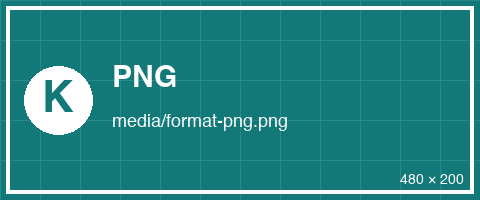 |
| Line break | first<br>second |
| Empty |  |
| Footnote | a note[^table-note] |
| Math | $a^2 + b^2$ |
| Unicode | Zoë · 東京 · مرحبا · 🐦‍⬛ |
| Long value | https://example.org/an/unusually/long/path/without/spaces/that/needs/wrapping/or/scrolling |

A wide table:

| C1 | C2 | C3 | C4 | C5 | C6 | C7 | C8 | C9 | C10 | C11 | C12 |
| --- | --- | --- | --- | --- | --- | --- | --- | --- | --- | --- | --- |
| alpha | bravo | charlie | delta | echo | foxtrot | golf | hotel | india | juliett | kilo | lima |

A table without a delimiter row is not a table:

| Header only |
| no delimiter row |

- A table inside a list item:

  | In | List |
  | --- | --- |
  | yes | it is |

**Look for:** alignment per column; missing cells padded and the extra cell dropped; the escaped pipes shown as `|`; the wide table scrolling or wrapping without breaking the layout; the delimiter-less example left as text.

## C2. Task lists [GFM]

- [ ] Open task
- [x] Done task
- [X] Done with a capital X
- [ ] Task with **bold**, a [link](https://example.org) and `code`
  - [x] Nested done task
  - [ ] Nested open task
1. [ ] A task in a numbered list
2. [x] A finished numbered task

- [ ]
- [] Not a task, because the brackets are empty
- [ ]Not a task either, because no space follows

> - [ ] A task inside a quote

**Look for:** real check boxes for the valid items; whether clicking one changes the source; the invalid forms left as text.

## C3. Strikethrough [GFM]

~~Two tildes~~ and ~one tilde~ and ~~~three tildes stay literal~~~

## C4. Extended autolinks [GFM]

Visit www.example.org or https://example.org/path.\
Trailing punctuation is not part of the link: https://example.org/path), (https://example.org/inside).\
A bare address: birdwatch@example.org.\
Not linked inside code: `https://example.org`

**Look for:** the full stops and closing parentheses outside the links; the address linked as `mailto:`.

## C5. Filtered raw HTML [GFM]

GitHub escapes a handful of tags that could take over the page. These are live:

<title>A title tag in the body</title>

<textarea>A textarea tag</textarea>

<iframe src="https://example.org" title="An iframe"></iframe>

**Look for:** none of them becoming a working form field or embedded page, and the text after this section still rendering normally. The more disruptive tags are in `fixtures/unsafe-html.md`.

---

# Part D — Common extensions

## D1. Footnotes [EXT]

A numbered footnote.[^1] A named footnote.[^kestrel] The numbered one again.[^1]

[^early]: This definition sits above the sentence that uses it.

A footnote whose definition comes before its reference.[^early]

A reference without a definition stays literal: [^missing]

A footnote with several blocks.[^long]

- A footnote inside a list item.[^list-note]

[^1]: The first footnote.
[^kestrel]: Named footnotes are numbered in order of first use.
[^long]: The first paragraph of a longer footnote.

    A second paragraph, indented to belong to the note.

    ```text
    and a code block inside it
    ```
[^list-note]: Referenced from a list item.
[^table-note]: Referenced from a table cell in C1.
[^unused]: Never referenced, so most renderers drop it from the list.

**Look for:** numbering by first use; one shared number for the repeated note; back-links from the notes; the missing reference left as text; the multi-block note intact.

## D2. Inline extensions [EXT]

==Highlighted text== (Obsidian, many editors)\
H~2~O with single-tilde subscript\
E = mc^2^ with caret superscript\
++Inserted text++ (rarely supported)\
Emoji shortcodes :bird: :white_check_mark: :tada:

**Look for:** which of these render, and that the source stays readable where they do not. Single tildes also mean strikethrough in GFM, so `H~2~O` may come out struck through.

## D3. Definition lists [EXT]

Kestrel
: A small falcon that hovers before it dives.

Heron
: A wading bird.
: Also a surname.

Term with *emphasis*
: A definition with `code` and a [link](https://example.org).

## D4. Heading attributes and table-of-contents markers [EXT]

### A heading with a custom ID {#custom-id}

### A heading with a class {.highlighted}

[Link to the custom ID](#custom-id)

[TOC]

[[_TOC_]]

**Look for:** whether `{#custom-id}` becomes the anchor or stays in the text; whether the TOC markers expand or stay literal.

## D5. Abbreviations and admonitions from other tools [EXT]

The HTML and CSS specifications are long.

*[HTML]: HyperText Markup Language
*[CSS]: Cascading Style Sheets

!!! note "MkDocs admonition"
    Indented content under an admonition.

:::tip Docusaurus admonition
Fenced with colons.
:::

**Look for:** these usually stay literal outside their own tools. In plain CommonMark the indented admonition body joins the paragraph above it, because indented code cannot interrupt a paragraph.

## D6. Mathematics [EXT]

Inline with dollars: $e^{i\pi} + 1 = 0$, and inline with parentheses: \(\sqrt{x^2 + y^2}\).

Display with double dollars:

$$
\int_{-\infty}^{\infty} e^{-x^2}\,dx = \sqrt{\pi}
$$

Display with brackets:

\[
\nabla \cdot \mathbf{E} = \frac{\rho}{\varepsilon_0}
\]

A display formula on one line: $$\sum_{n=1}^{\infty} \frac{1}{n^2} = \frac{\pi^2}{6}$$

Alignment:

$$
\begin{aligned}
(a + b)^2 &= (a + b)(a + b) \\
          &= a^2 + 2ab + b^2
\end{aligned}
$$

A matrix and a case distinction:

$$
R(\theta) = \begin{pmatrix} \cos\theta & -\sin\theta \\ \sin\theta & \cos\theta \end{pmatrix},
\qquad
|x| = \begin{cases} x & \text{if } x \ge 0 \\ -x & \text{otherwise} \end{cases}
$$

Greek, operators and decorations: $\alpha, \beta, \Gamma, \Omega$, $\hat{x}, \bar{y}, \vec{v}, \dot{z}$, $\leq, \neq, \approx, \infty, \partial$, $\mathbb{R}, \mathcal{L}, \mathfrak{g}$

GitHub inline style: $`\frac{a_1}{b_1} + \frac{a_2}{b_2}`$

GitHub fenced style:

```math
\binom{n}{k} = \frac{n!}{k!\,(n-k)!}
```

Dollars that are money, not math: the ferry costs $12 and the bus $3.50, so $15.50 in total.\
An escaped dollar: \$5 stays a price.\
Math in a list:

- $x_1 + x_2$
- $\lim_{h \to 0} \frac{f(x + h) - f(x)}{h}$

A long formula that should scroll or wrap rather than overflow the page:

$$
f(x) = a_0 + a_1 x + a_2 x^2 + a_3 x^3 + a_4 x^4 + a_5 x^5 + a_6 x^6 + a_7 x^7 + a_8 x^8 + a_9 x^9 + a_{10} x^{10} + a_{11} x^{11} + a_{12} x^{12}
$$

Invalid LaTeX should show an error or the source, never nothing:

$$
\frac{1}{
$$

**Look for:** each delimiter style; money amounts left alone; the escaped dollar; the long formula contained; the broken one visible; how math is exported to HTML, PDF and Word.

## D7. Mermaid diagrams [EXT]

Flowchart with a subgraph and a styled node:

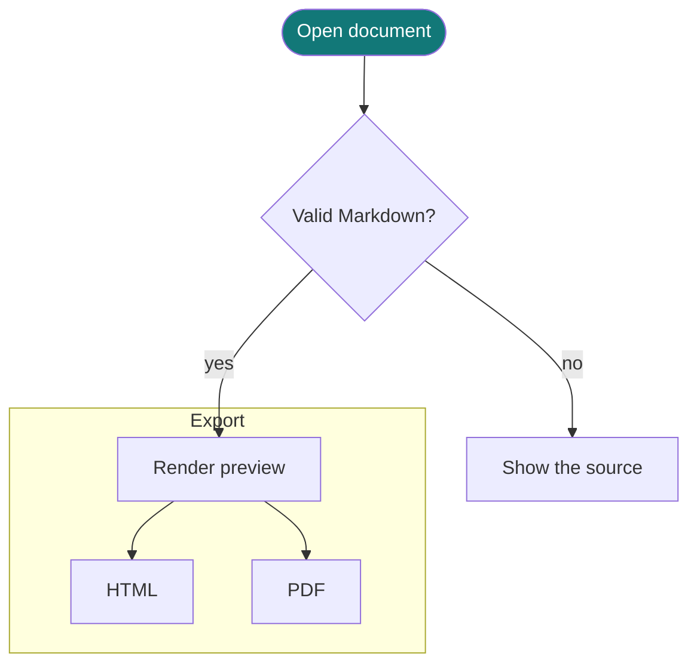

Sequence with a loop, an alternative and a note:

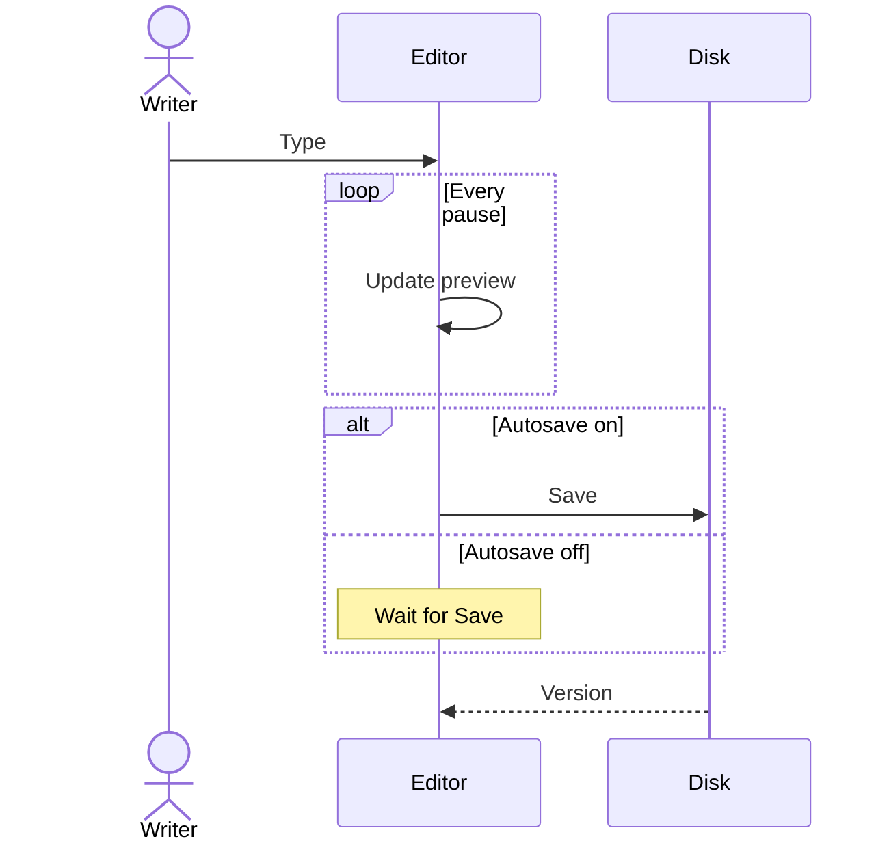

Class, state and entity-relationship diagrams:

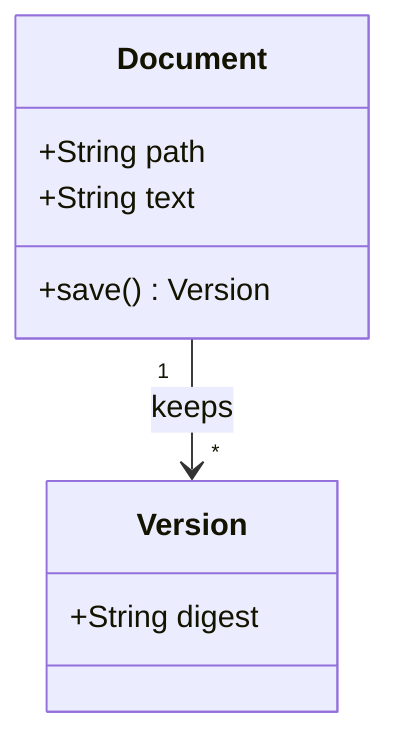

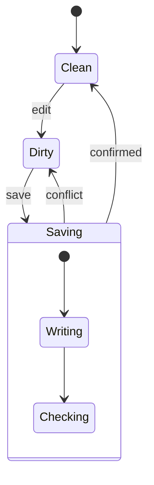

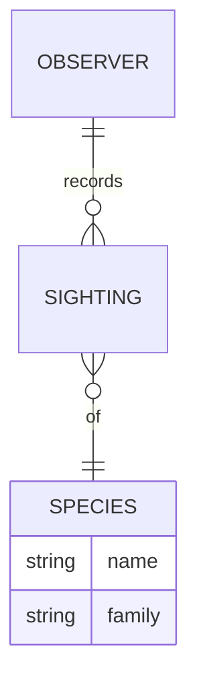

Charts and timelines:

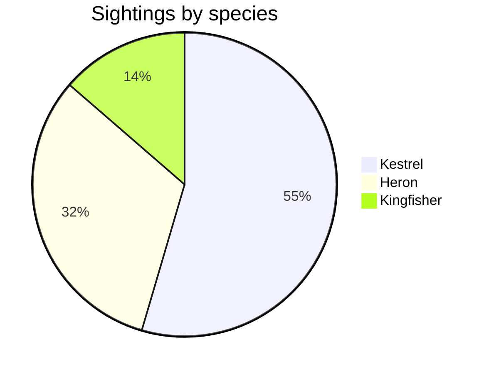

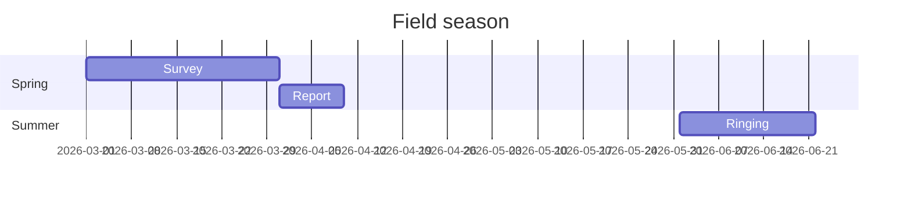

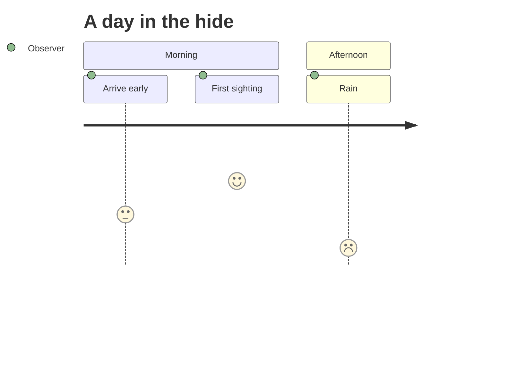

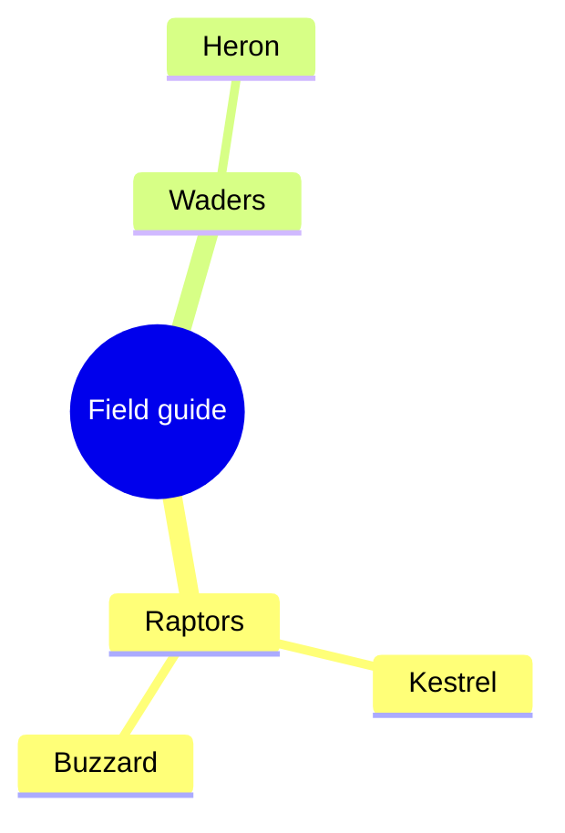

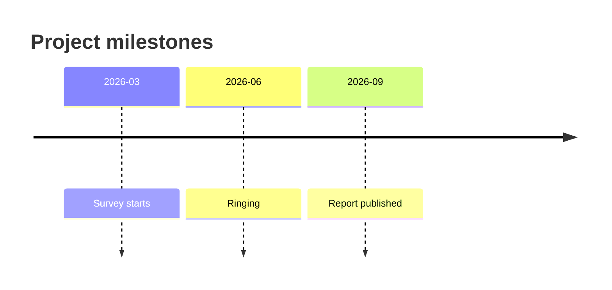

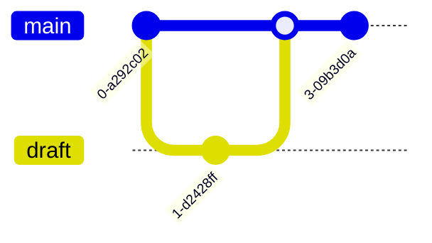

A configuration directive and an invalid diagram:

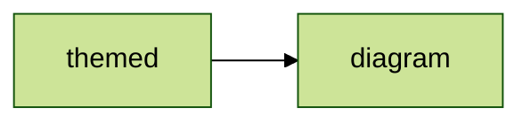

```mermaid
flowchart LR
    this is --> not valid mermaid -->
```

**Look for:** every supported type drawn; unsupported types or the invalid diagram showing an error or the source instead of vanishing; diagrams following the light or dark theme; diagrams in exported HTML and PDF.

---

# Part E — Obsidian

## E1. Wiki-links [OBS]

[[notes/Project Kestrel]]\
[[notes/Project Kestrel|Kestrel project, with an alias]]\
[[notes/Project Kestrel#Field notes]]\
[[notes/Project Kestrel#^kestrel-sighting]]\
[[notes/Project Kestrel.md]]\
[[A note that does not exist]]

## E2. Embeds [OBS]

![[media/format-png.png]]

![[media/format-png.png|240]]

![[Pasted image 20261124101500.png]]

![[notes/Project Kestrel#Field notes]]

**Look for:** outside Obsidian these normally stay literal. The bare file name in the third embed relies on Obsidian searching the whole vault.

## E3. Callouts [OBS]

> [!note]
> A plain note.

> [!tip] A custom title
> With a list:
> - one
> - two

> [!warning]- Folded until opened
> Hidden at first.

> [!danger]+ Open, but foldable
> Visible at first.

> [!question] Nested
> > [!example] Inner callout
> > ```text
> > code inside a nested callout
> > ```

> [!info]
> [!success]
> [!failure]
> [!bug]
> [!quote]
> [!abstract]
> Each line above is text after the first marker, so only the first one makes a callout.

> [!unknown-type] An unknown type
> Usually shown like a note.

> [!NOTE]
> Upper-case types are the GitHub alert style.

## E4. Tags, comments and block IDs [OBS]

Tags: #birding #field/2026 #to-do_list\
Not tags: #123 is a number, `#tag` is code, \#escaped is escaped, and the heading syntax needs a space.

An inline comment %%that Obsidian hides%% sits in this sentence.

%%
A block comment.
Obsidian hides all of it.
%%

A paragraph with a block ID. ^field-paragraph

**Look for:** outside Obsidian the comments may be visible. That is expected, but check that they are not mistaken for something else.

---

# Part F — Images and files

## F1. Image formats [APP]


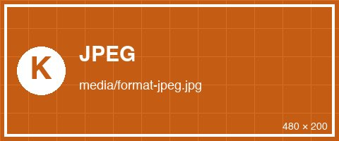

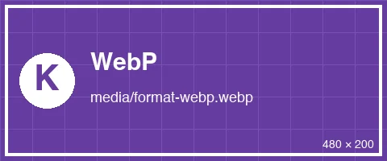

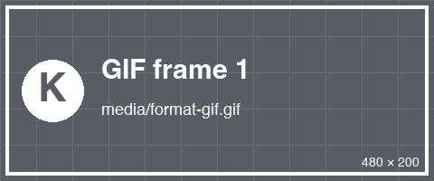


**Look for:** each image showing its own label; the GIF animating; how SVG is handled; the fake PNG refused rather than shown as a broken page element.

## F2. Image paths [APP]


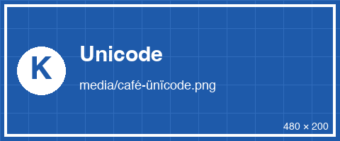


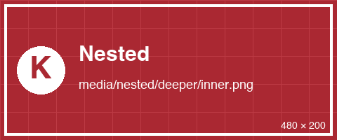


**Look for:** the first six shown; the missing ones reported clearly with their alt text; no path turning into a request to the internet.

## F3. Remote and embedded images [APP]


**Look for:** whether remote images load, are blocked until approved, or are blocked outright; whether plain HTTP is treated differently; whether a data URI is shown.

## F4. Image variants [APP]

![Reference-style image][reference image]

[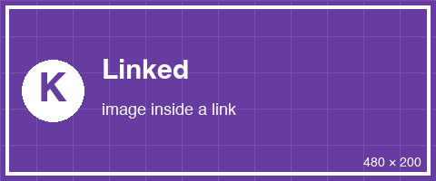](https://example.org "Image link")


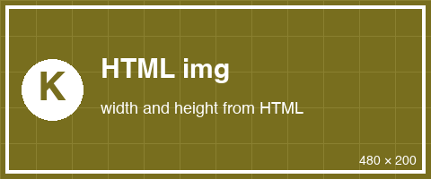

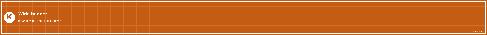

[reference image]: media/reference.png "Reference-style image"

**Look for:** the reference image resolved; the image link clickable; the empty alt text kept in the source; the HTML image at its stated size; the wide banner scaled to the page.

## F5. Links to other files [APP]

[A note with a space in its name](notes/meeting%20notes.md)\
[The same note, angle brackets](<notes/meeting notes.md>)\
[A note with a non-ASCII name](notes/überblick.md)\
[A heading in another note](notes/Project%20Kestrel.md#field-notes)\
[An accented heading in another note](notes/Project%20Kestrel.md#équipe--planning)\
[A folder](media/)\
[A file that is not Markdown](media/vector.svg)\
[A missing note](notes/does-not-exist.md)

**Look for:** Markdown targets opening in the application, ideally at the heading; the folder and the SVG handed to the system or refused clearly; the missing note reported.

## F6. Links to headings in this document [APP]

[A7. Lists](#a7-lists-cm)\
[The second "Results" heading](#results-1)\
[Ünïcode & Punctuation](#anchor-target-ünïcode--punctuation)\
[Part D](#part-d--common-extensions)\
[A heading that does not exist](#no-such-heading)

**Look for:** each link scrolling to its heading, using GitHub-style anchors; the last link failing quietly.

---

# Part G — Safety

The tests below use harmless signals. If one of them works, the window title changes, text turns red or an alert appears, rather than anything worse happening.

## G1. Scripts and event handlers [HTML]

<script>document.title = "Script in the document ran";</script>


<a href="javascript:document.title='javascript: link ran'">A javascript: link</a>

[A Markdown javascript: link](javascript:document.title='Markdown%20javascript%20link%20ran')

[A data: link](data:text/html,<p>Opened%20a%20data%20link</p>)

<button onclick="document.title='button ran'">A button with an onclick handler</button>

<style>
  * { color: red !important; }
</style>

<form action="https://example.org/collect"><input name="field" value="A form field"></form>

**Look for:** the window title unchanged after clicking everything above; the rest of the document not turning red; no form that can be submitted. The `<style>` element and the form show whether sanitising is strict.

## G2. Mermaid interaction [EXT]

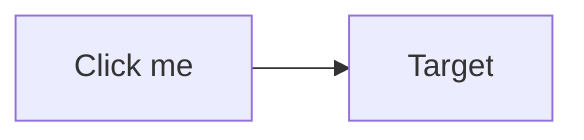

**Look for:** the callback never running. A link from a diagram may be allowed or removed.

---

# Part H — Text and whitespace

## H1. Scripts, accents and symbols [APP]

Dutch: één, coördinatie, geïnteresseerd, IJsselmeer, ’s ochtends\
German and Nordic: Straße, Größe, Ærø, Øresund, Åland\
French and Spanish: œuvre, garçon, ¿qué?, ¡olé!\
Greek and Cyrillic: Καλημέρα, Здравствуйте\
Right to left: עברית בתוך English, العربية في النص\
CJK: 日本語の文章, 中文文本, 한국어 문장\
Thai: ภาษาไทย\
Emoji: 🐦 🦅 👩🏽‍🔬 👨‍👩‍👧 🏳️‍🌈 🇳🇱 1️⃣\
Mathematical letters: 𝐁𝐨𝐥𝐝 𝘐𝘵𝘢𝘭𝘪𝘤 𝔉𝔯𝔞𝔨𝔱𝔲𝔯\
Fullwidth: Ｍａｒｋｄｏｗｎ\
Composed café and decomposed café look alike but differ in bytes.\
A zero-width space hides here:​between the colon and the word.\
A soft hyphen allows Wieder­verwendbarkeit to break.\
A non-breaking space joins 10 km.

**Look for:** correct glyphs and direction; search finding "café" in both forms (or deliberately not); the emoji sequences kept whole when copied; the invisible characters kept after saving.

## H2. Length [APP]

A long paragraph for wrapping. Kestrels hunt by hovering into the wind with rapid wing beats and a fanned tail while the head stays perfectly still, then drop onto voles, beetles and the occasional lizard; observers who count them along a fixed route every week build up a record that shows how populations rise after a good vole year and fall again after a wet spring, which is exactly the kind of quiet, repetitive note-taking a plain text editor should make pleasant rather than tiring.

A long token without spaces: KestrelFalcoTinnunculusObservationRecordNumberTwentyTwentySixNovemberWithoutAnyBreakOpportunity

[A link with a very long text that should wrap like ordinary words instead of running off the right edge of the preview](https://example.org)

## H3. Whitespace [APP]

This line ends with three spaces, which makes a hard break.   
This is the line after it.

	This line starts with a tab, so it is indented code.

    These leading non-breaking spaces do not make code.


The four blank lines above should collapse into one paragraph break in the preview and stay four in the source.

## H4. Counting [APP]

This sentence has exactly ten words in it, counted carefully.

Hyphenated words, numbers and links count differently per application: twenty-six birds, 3.5 km, 2026-11-24, https://example.org/count.

**Look for:** the ten-word sentence counted as ten; how the second sentence is counted; whether the front matter at the top is left out of the word count.

---

# Part I — Ambiguous source, shown literally

Each case below sits in a code block so it cannot disturb the rest. Paste one into a new document to see how it is parsed and whether the application changes it.

````markdown
Is this a heading or a list?
- 

*An asterisk **with mixed* closing**

[A reference with no definition][nowhere]

`An unclosed code span

<div>
An HTML block without a blank line **does not parse Markdown**
</div>

1986. A good year for kestrels.
1986\. The escaped version stays a sentence.

+1 for this idea, written at the start of a line.

#5 on the list, written at the start of a line.

| A header row | without a delimiter row |
| just | text |

```unclosed
A fence that never closes runs to the end of the document.
````

---

# Part J — Application behaviour

## J1. Page breaks for print and PDF [APP]

Text before a page break.

<!-- pagebreak -->

Text after a page break. In print or PDF it should start on a new page. Elsewhere the comment stays invisible.

## J2. Comments [HTML]

Visible before.

<!-- A single-line HTML comment. -->

<!--
A multi-line HTML comment
with **Markdown** that must not render.
-->

Visible after.

## J3. Headings that are not headings [APP]

```markdown
# A heading inside a code block
## must not appear in the outline
```

> Quoted text that looks like a heading:
> # but is one, inside the quote

**Look for:** the fenced lines left out of the outline; the quoted heading included or not, consistently between outline, folding and export.

## J4. Separate fixture files [APP]

Work on a copy of each file in `fixtures/`. For each editable file, add one ASCII letter without changing the number of lines, save, undo the edit and save again. Compare the copy with the original byte for byte. For a file Kladje refuses to open, check the message and verify that the file is untouched.

| File | What it checks |
| --- | --- |
| `lf.md` | Plain UTF-8 with LF line endings. |
| `crlf.md` | Windows line endings are kept on save. |
| `cr-only.md` | Classic Mac line endings: kept, converted with a notice, or refused. |
| `mixed-endings.md` | A mix of LF, CRLF and CR. |
| `utf8-bom.md` | A UTF-8 byte-order mark is kept. |
| `latin1.md` | A Latin-1 file is detected and saved back as Latin-1, or converted with a notice. |
| `utf16le-bom.md` | UTF-16 is opened correctly or refused with a clear message, never shown as garbage. |
| `no-final-newline.md` | No newline is added unasked. |
| `empty.md` | An empty file opens and saves as empty. |
| `only-front-matter.md` | Front matter with no body. |
| `nul-byte.md` | A NUL byte: refused, or kept without corrupting the rest. |
| `unsafe-html.md` | Tags that could navigate away, restyle or replace the preview. |

---

# Part K — Round trips and export

Work on copies, never on this file.

### K1. Markdown to Markdown

Open this document, change one word, save under a new name and compare the two files with a diff tool. Note every change you did not make: front matter, heading styles, list markers, numbering, blank lines, trailing spaces, line endings, fences, escapes, reference definitions, HTML, comments and image paths.

### K2. Through rich text

Copy the preview into a word processor or rich-text editor, then copy it back or convert it to Markdown again. Compare structure and meaning rather than exact characters. Footnotes, math, diagrams, callouts, wiki-links, comments and front matter are the usual casualties.

### K3. HTML and PDF export

Export the same document to HTML and PDF. Kladje can import Word documents. Record DOCX export as **N/A** when comparing Kladje with other editors.

- headings usable for navigation in HTML;
- links working and footnotes linked both ways;
- images embedded at a sensible resolution, with alt text;
- wide tables readable in the PDF, with all columns and rows visible;
- code in a monospaced font, wrapped rather than clipped;
- math and diagrams present, as images, MathML or text;
- the page break in J1 honoured, and no heading left alone at the bottom of a page;
- text in the PDF selectable and searchable;
- nothing from Part G active in the HTML export.

---

# Scorecard

| Code | Area | ✅ | ◐ | ○ | ✗ | – | Notes |
| --- | --- | :-: | :-: | :-: | :-: | :-: | --- |
| A1–A2 | Headings | | | | | | |
| A3 | Duplicate headings and anchors | | | | | | |
| A4–A5 | Paragraphs, breaks and rules | | | | | | |
| A6 | Block quotes | | | | | | |
| A7 | Lists | | | | | | |
| A8 | Code blocks and colouring | | | | | | |
| A9 | Reference definitions | | | | | | |
| B1–B2 | Emphasis and code spans | | | | | | |
| B3–B4 | Links and autolinks | | | | | | |
| B5 | Escapes and entities | | | | | | |
| B6 | Inline HTML | | | | | | |
| C1 | Tables | | | | | | |
| C2 | Task lists | | | | | | |
| C3–C4 | Strikethrough and extended autolinks | | | | | | |
| C5 | Filtered HTML | | | | | | |
| D1 | Footnotes | | | | | | |
| D2–D5 | Other extensions | | | | | | |
| D6 | Math | | | | | | |
| D7 | Mermaid | | | | | | |
| E1–E4 | Obsidian syntax | | | | | | |
| F1–F4 | Images | | | | | | |
| F5–F6 | File and heading links | | | | | | |
| G1–G2 | Safety | | | | | | |
| H1–H4 | Text, whitespace and counting | | | | | | |
| I | Ambiguous source | | | | | | |
| J1–J4 | Application behaviour and fixtures | | | | | | |
| K1 | Markdown round trip | | | | | | |
| K2 | Rich-text round trip | | | | | | |
| K3 | HTML and PDF export | | | | | | |

**Summary**

- Application and version:
- Operating system:
- Date:
- Works well:
- Works partly:
- Not supported, source kept:
- Loses or changes content:
- Verdict for a Markdown round trip: identical / equivalent / lossy
