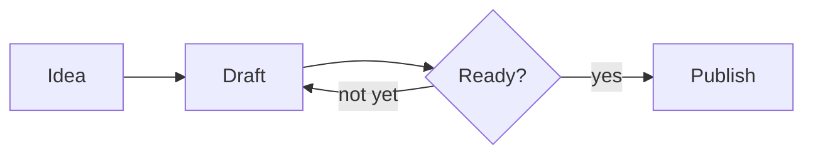

# Markdown Guide

Write on the left, read on the right. This page shows everything Kladje understands — edit it freely, it is only a copy. You can always get it back from **Help → Markdown Guide**.

## Text

Press Enter twice for a new paragraph. By default, Kladje shows a single Return inside a paragraph as a line break in the preview, PDF, HTML export, and formatted copies. Turn off **Show a single Return as a line break** in **Settings → Preview** to let the lines flow together, as they do in GitHub’s Markdown files. Inside a paragraph you can use *italic*, **bold**, ***both***, ~~strikethrough~~, ==highlight==, `inline code`, H~2~O and x^2^.

A line ending in a backslash\
always keeps its line break, in Kladje and in other Markdown readers.

## Links and images

[A link](https://commonmark.org "with a title"), a bare address like https://example.com, and a [reference link][ref].

Use **Format → Insert Local Image** or drop a PNG, JPEG, GIF or WebP. Save an untitled document first so Kladje can use a relative path. When a picture is outside the document folder, you can copy it beside the Markdown file. Replace the selected description with meaningful alt text. The result looks like ``.

HTTPS images require permission in **View → Remote Images for This Document**. An unavailable image shows its description. Standalone HTML embeds supported local images so the exported file can move. PDF uses the current rendered document, including when only the editor is visible. In **Settings → Preview**, choose dark colors for HTML and PDF independently of the editor. On macOS you can also include page numbers, the document title and the print date.

**View → Check Document** lists missing local files and images without a description by line number. Save the document to check relative paths. The check stays inside its folder and skips web addresses.

Relative Markdown links can include a section, as in `[Notes](meeting%20notes.md#decisions)`. A second heading with the same name gets the suffix `-1`. External links open with the system handler.

Use **⌘1–⌘6** on macOS for heading levels and **⌘⌥0** for a paragraph. **⌘0** restores default text size. Tab to the splitter, resize with the arrow keys, press Enter to center it or Escape to return to the source. In the editor, Escape followed by Tab moves keyboard focus out of the writing area. In Find and Replace, use Tab or Shift-Tab to move between fields, options and buttons. Space activates a focused button.

[ref]: https://github.github.com/gfm/

## Lists

Press Enter to continue a list. Press Enter on an empty item to leave the list.

- Bullets start with a dash
- Indent to nest
    - like this
    - and this
- Back at the first level

1. Numbered lists
2. Count for you
3. In the preview

- [x] Task lists
- [ ] Show checkboxes

Term
: Definition lists pair a term with its explanation.

## Quotes and callouts

> A quote starts with a greater-than sign.
> It can span several lines.

> [!NOTE]
> Callouts are quotes with a label: NOTE, TIP, IMPORTANT, WARNING or CAUTION.

> [!WARNING]
> Use them sparingly.

## Code

Fenced code in JavaScript, TypeScript, HTML, CSS, Python, Rust, shell and YAML has syntax coloring in the editor.

```rust
fn main() {
    let name = "Kladje";
    println!("Hello from {name}!");
}
```

```json
{ "light": true, "fast": true, "bells": 0 }
```

## Tables

To turn copied spreadsheet rows into a table, enable **Paste spreadsheet cells as a Markdown table** in Settings and paste on an empty line. The first row supplies the column headings. Use Paste as Plain Text to keep the tabs.

| Shortcut | Action | Notes |
| :-- | :-- | --: |
| Ctrl/Cmd + B | Bold | toggles |
| Ctrl/Cmd + K | Link | selection becomes the text |
| Ctrl/Cmd + Alt + 1 / 2 / 3 | Editor, both, preview | or the buttons bottom right |

## Math

Inline math sits between dollar signs: $e^{i\pi} + 1 = 0$. Display math gets its own block:

$$
\int_{-\infty}^{\infty} e^{-x^2}\,dx = \sqrt{\pi}
$$

## Diagrams

A fenced code block tagged `mermaid` is drawn as a diagram in the preview, in PDF and in exported HTML:



Flowcharts, sequence, class, state and entity diagrams, Gantt charts, pie charts and the other [Mermaid](https://mermaid.js.org) diagram types work. If a diagram cannot be drawn, its text stays visible with a short reason below it. Double-click a diagram to go to its source. Other Markdown readers that do not know Mermaid show the same block as code.

## Footnotes and more

Footnotes keep the text clean.[^1] Emoji shortcodes work too :sparkles:, and so does a little HTML such as <kbd>Ctrl</kbd> + <kbd>S</kbd>.

<details>
<summary>Collapsible section</summary>

Hidden until opened.

</details>

[^1]: The note itself can live anywhere in the document.

## Returning to your writing

**File → New** and **File → Open** each open a separate document window, placed a little below and to the right of the others. Opening a file that is already open brings its window forward. On macOS, **File → New Tab** (⌘T) opens a document in the current native tab group. **Window → Move Tab to New Window** detaches it.

**Close Window** (⌘W on macOS) asks about changes in that window. **Quit** asks about each unsaved document. Cancel keeps all windows and their edits available. A Save you already approved stays on disk. After an unexpected exit, choose **Restore** for each draft you want to reopen.

**File → Open Recent** remembers ten documents on this device. Choose **Clear Recent Documents** to forget their paths and saved places. If a file moved, choose **Locate…** when you reopen it. An unchanged document restores its last saved editing position.

Press **⌘⇧J** on macOS (Ctrl+Shift+J elsewhere) to search headings. Type part of a heading, press the down arrow to select a match, and press Enter to jump. Escape returns to the document.

Use **View** or **Settings** to toggle line numbers, wrapping or a narrower writing width. The footer counts Unicode code points and word-like segments of Markdown source. A document above 262,144 UTF-16 code units shows its line count first and its totals once a background count finishes. **Format → Table → Add Row Below** adds an empty row with the same number of columns.

## Large documents

Kladje times each preview update. While an update stays short, the preview follows your typing. In a larger document it updates when you pause typing, and in a very large one when you choose **View → Refresh Preview** (⌘⌥R, or Ctrl+Alt+R). A note in the corner of the preview says which applies and offers the same refresh. On an Apple M4 the preview stays live up to about 2 MiB of mixed Markdown and updates on a pause up to about 10 MiB. **Export → PDF / Print** renders the whole document first at any size that opens, and says so while it prepares.

## Saving automatically

Kladje saves when you press **⌘S**. To have it save for you, turn on **Save automatically** in **Settings**. A document that already has a file is then saved two seconds after you stop typing, when you switch to another window, and when you close it. A new document still needs a first Save to give it a name.

Autosave never asks a question. If the file changed on disk, or a save would need a decision about encoding or line endings, it pauses and says so at the bottom of the window. Use **Save**, **Save As** or **File → Compare with Disk** to settle it, and autosave resumes after the next successful save.

## Reusing writing and images

**File → New from Template** copies the text of a local Markdown or plain-text file into a new, unsaved draft. Save it where you want the new document. Relative image links resolve beside the saved draft.

Paste a clipboard image into the source editor and confirm **Save Image**. For an untitled draft, first choose where to save the document. Kladje stores a new PNG, JPEG, GIF or WebP of up to 4 MiB in the adjacent `assets/` folder and selects the image description. Undo removes the link. The image remains in the folder, so other documents can still use it. Move that folder with the document.

Choose **File → Compare with Disk** to see your text and the saved file side by side. Changed lines are tinted, the changed words inside them are marked, and long unchanged stretches fold away. **Next Change** and **Previous Change** step through the differences. You can select and copy from either side, and neither side can be edited. Closing the comparison returns to your edits. Save As keeps a separate copy if you want to keep both versions. Comparison ignores line-ending and encoding differences and supports up to 512 KiB on disk and 524,288 UTF-16 code units in the editor.


## Writing shortcuts

The formatting bar along the bottom of the source has headings, a task, lists and callouts, bold, italic, highlight, link, table and image, and more under the last button. Arrow keys move along the bar; the Up arrow opens a button's menu. Hide it with **View → Formatting Bar** (⌥⌘B) or in **Settings**.

**Format** also inserts a footnote (⌥⌘F), which takes the next free number and starts its text at the end of the document, a callout, inline or block math, and today's date. **File → Rename…**, **Move To…** and **Duplicate** work on the open document. Rename and Move To never replace another file and keep unsaved edits in the window; Duplicate opens a copy of the text as it is now.

Use **Kladje → Settings…** (⌘,) on macOS or **File → Settings…** on other desktops. **General** covers saving and pasting, **Editor** the formatting bar, layout and focus, **Preview** line breaks and scrolling, and **Appearance** the theme, text size and a monospaced or proportional editor font. Normal paste keeps plain text by default. With URL paste enabled, select a label and paste an HTTP or HTTPS address. With rich-text conversion enabled, paste formatted content to insert Markdown. Shift with the platform’s plain-paste shortcut bypasses these conversions. **Edit → Copy as Formatted Text** puts both Markdown source and formatted HTML on the clipboard, for a selection of up to 4 MiB.

Use Tab and Shift-Tab to select adjacent GFM table cells. **Format → Table** adds rows above or below and columns before or after the cursor, moves a row, aligns a column, deletes a row or column, and **Tidy Table** pads the columns so the source lines up. Choose **Format → Fold or Unfold at Cursor** on a heading, or **Fold All** and **Unfold All**. **⌘E** opens Find with the current selection; **⌘⇧C** toggles inline code. Fenced JavaScript, TypeScript, HTML and CSS have editor syntax colors. A closed initial frontmatter block stays in the file and is excluded from the prose word total.

Click a standard list checkbox in the preview or focus it and press Space to change its Markdown marker. Undo restores it. Checkboxes stay read-only in exports, tables and documents containing raw HTML. The status bar shows the encoding and line endings of the current document. Optional reading time uses 200 words per minute.

Choose **View → Document Outline**, or the outline button at the bottom right, to keep headings beside your document. They are indented by level, and the section that holds the cursor is marked. Click a heading to go there, or filter and press Enter. The arrow next to a heading folds its subheadings away; with the keyboard, Left and Right do the same. The close button or Escape returns the space to the document. Windows 800 pixels wide or smaller use the compact heading picker. Tab in the final table cell adds a blank row.

Settings can emphasize the current paragraph or keep the caret centered while you type. Both options start off. You can still scroll through the document and use Find.

Standalone HTML exports recognize a simple, single-line `title` and `lang` at the top level of initial frontmatter. For example, `lang: nl-BE` sets the document language. An omitted or unsupported title uses the first level-one heading, then the filename. Put `<!-- pagebreak -->` on a line between paragraphs to start a new printed page.


### Changes from another application

A clean document reloads when its active window notices an external edit. If you have unsaved changes, **Keep Edits** preserves your draft and pauses automatic saving. Use **File → Compare with Disk** to review the differences or **Save As** to keep a separate copy. A missing file stays open for recovery.

If another program writes during an exFAT save, **Save My Version Separately…** saves your editor text in a new folder beside the file. You continue editing the copy, so relative image and link paths resolve from that folder. **Keep Editing** keeps your draft and its recovery. If autosave detects this conflict, press **Save** to see the choice.
